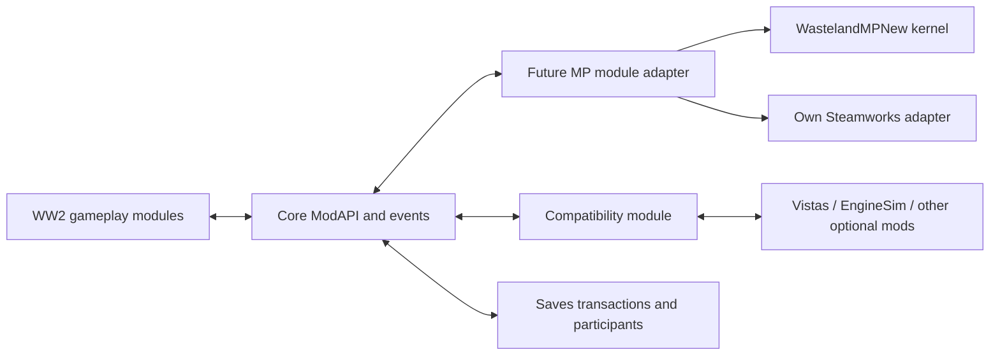

# WW2 integration handoff

The current WW2 `docs/refactor/README.md` section0 overrides the pasted original plan. D11 creates separate WW2, D12 removes WW1 migration, D13 moves assets with their module, D17 requires `AtomicFile.Replace` for replacement writes. This package changes none of those repositories' production sources.

## Ownership and dependencies

The future MP module is an **explicit later extension** to the approved16-module refactor, not a seventeenth module silently added during a current wave. Its kernel may be source-included or privately referenced; retain one implementation of each concern. Register only its Core adapter from ModuleRegistry once integration is requested. Do not recreate the old Core static `Multiplayer` patch cluster or import native `WorldObjects`.

Only Core contracts appear in the adapter. `ModApi.Get<T>()` must handle missing providers; caches observe `ModApi.Changed` or are limited to one frame. Core references no MP module class outside ModuleRegistry. Gameplay and Compatibility never reference `WastelandMPNew` types directly: Core-facing DTOs and interfaces are the shared boundary. Compatibility implements the Vistas/EngineSim capabilities; the MP adapter asks Core for them.

## Implement the frozen event transport

The future adapter implements the existing planned `WildWasteland.Core.ModApi.IEventTransport`:

- `ShouldSend(Type, Authority)`: cached explicit codec registration; session ready; no send for Local; Host or Owner checks against current session/entity policy. A type-level Owner flag cannot alone authorize a particular entity: `Send<T>` extracts that event's identity and verifies it again.
- `Send<T>(ref T)`: explicit compile-time codec writes to a reusable buffer; selects route/lane, host relay policy and operation revision. No `BinaryFormatter`, auto-reflection struct serialization, `Assembly.GetTypes`, scene object references or delegates in payloads.
- Receive: obtain sender from link, validate epoch/route/payload/direction/ownership/reach/rate, decode the known struct, then invoke `ModEvents.ApplyRemote<T>(ref evt)` to avoid re-sending. Do not publish partially decoded input. Host validates guest intent and emits a distinct committed event when the domain requires authority.

Core events currently use ref payloads and local subscribers run before forwarding; every world-mutating publisher must already gate authority before local side effects. A network check after local subscribers cannot undo an unauthorized local debit/spawn. Runtime provider removal/shutdown must remove subscriptions and transport service ownership before disposing links.

No copy of `IModEvent`, `Authority`, `EntityId`, `ModApi`, `ModEvents` or `IEventTransport` is compiled into this package. Those types are owned by WW2 W0. The [contract request](requests/WW2-MP-contract-additions.md) records the remaining network capabilities; it must go through the coordinator rather than editing frozen signatures in a feature package.

## Domain adapter map

| Planned Core contract/events | WW2 owner | MP adapter responsibility |
|---|---|---|
| Entities, Origin, WorldIndex/WorldTiles/FsmIndex | Core | Bind host entity manifest; world-space encoding; lifecycle invalidation; no independent full scene scan |
| ICharacterPresentation/ICharacterAppearance/ITraversal/ISeatPoses; CharacterAction/ModelChanged/Voice | Presentation | Admitted player/actor visual snapshots, shared model id and speaker identity, crawl/seat/traversal state; no duplicate animation driver |
| INpcApi/INavApi/IPopulation/IFollowers; NpcSpawned/StateChanged/Killed, nest/burrow/pounce/dog events | NPCAI | Host decision authority; targetable remote players as perception inputs; guests reconstruct presentation only |
| IWeaponCatalog/IWeaponStats/IWeaponState; WeaponFired/Projectile*/Hurt/Magazine* | Gunplay | Intents versus committed damage; finite/geometry validation; combat ordering; ammo and resource grants before credit |
| IVehicleFactory/IVehicleIgnition/IVehicleControls/IVehicleOwnership; VehicleSpawned/ControlsState/Ignition/PartHit | Vehicles (+Compatibility providers) | Owner revisions, current snapshots, seat arbitration, attach/detach dependencies, exact saved parts and owner physics |
| IPatrols/IVehicleRouting/ICullingProtection/IFollowerVehicles | Patrols | Host journeys/crew/merchant stock and bounded guest mirrors; prevent cleanup of anchors/sleepers |
| IPoiApi/ITownsApi/IWorldLocations | POI | Host spawn/progress and deterministic site identity; guests consume world geometry and registries |
| IWeatherRegions/IShelterRegistry/IDayLight | Survival | Host world weather/hazards, owner forces, remote shelter and per-camera rendering |
| ILootTables/ILootSpawning | Loot | Host loot generation, registered item ids and idempotent creation; stock/cargo exclusion |
| IQuestApi/IQuestConversation | Quests | Host quest state and rewards; guest interaction nonce/sequence; explicit per-player wallet target |
| IMapMarkers/ICompassMarkers/INotifications/IQuestPresentation | HUD | Local display; host discovery-policy/shared data; save/join notices as presentation, not authority |
| ISaves, SaveBus, Sidecars, AtomicFile | Saves/Core | Ready-owner report barrier, all-player snapshot participants, optional tool state, backup/recovery; sticky failure |
| Optional capabilities proposed below | Compatibility | Version-tolerant signature binding, same capability manifest on all required peers; no third-party direct calls from MP |

## Ordered integration work

1. **Contract gate after W0.** Read current amended plan and reports. Record required session/ownership/snapshot/transaction/optional capability requests. Core owns DTOs and lifetime rules. Do not start the full singleplayer refactor again from the archived work-package prompts.
2. **Bootstrap/session.** Create one module-owned coordinator with injected Core clock, fair scheduler, debug counters and deterministic cleanup. Select/pin save through Saves; use HostLaunchGate; open networking only after exact world-ready. Subscribe to game-owned Steam readiness; queue invites/command-line intents until the menu can join. Implement bounded bootstrap and epoch exchange. UDP needs trusted key provisioning before it can be offered as public HOST/JOIN.
3. **Minimum complete native world.** Implement host authoritative entity create/despawn/ownership plus saved/runtime id domains, spawn tombstones, snapshot producer/apply participants and immutable generation handles. Load host settings before guest scene entry. Final receipt, complete digest, inventory restore and supported safe placement precede Ready. Do not infer ES3 reference parity before explicit bindings.
4. **Gameplay slices.** Integrate one vertical path at a time: player presence/input; native objects and inventory; driving/seats/parts; combat/resources; world AI/traffic; quests/reputation; sleepers/respawn; fog/locations; optional tools/weather. Each path includes join-in-progress, late delta, leave, save and reload behavior before the next path is advertised.
5. **Persistence gate.** Saves owns one transaction. Freeze/filter ready participants, capture actual owner reports, then cache world+players+optional supplements; flush/publish through existing journal and AtomicFile. Warning timeout never says all pending edits were saved. Save-and-exit serializes before title teardown. Loading an older snapshot uses matching player generation.
6. **Compatibility gate.** Implement Vistas through a capability provider first: generation policy, weather/clock, owner mutation guards, final-terrain invalidation/probe. Add EngineSim/Ultimate Tools and other bridges using the matrix. Required missing gameplay bridge fails admission; purely local optional features degrade gracefully.
7. **Human/performance gate.** Build and inspect module reference rules, then Denis verifies UDP/Steam two-peer and three-peer gameplay, old/new WW2 save generations, interrupted joins/writes, and Debug/ModProfiler captures. Only after acceptance expose release controls and package the optional MP runtime.

## Save and identity decisions

WW2 starts fresh. Do not import WWMP player registry, old username records, cfg sections, fog files, type aliases or optional mod data as part of this integration. Within WW2, keep the agreed current save schemas/keys and register all participants centrally. Network ids and schema versions are independent of serialized component type names. Never add mod components to saved objects as a shortcut.

Persist optional tools in the real world transaction and full backups, not config. Saved authority state includes world generation and player identities. Connection handles are transient; Steam user ids or explicitly provisioned UDP account credentials are durable identities only under a defined identity policy. A per-install GUID is not an authentication credential.

No host migration until a separately designed protocol transfers complete committed world+player+transaction state. Steam lobby ownership changing is insufficient.
